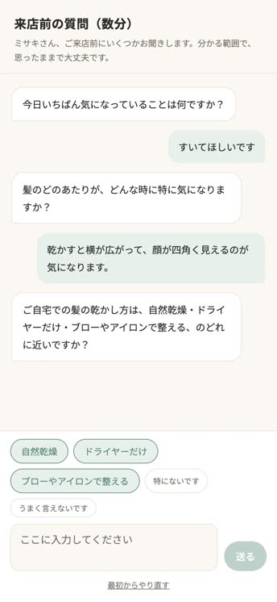
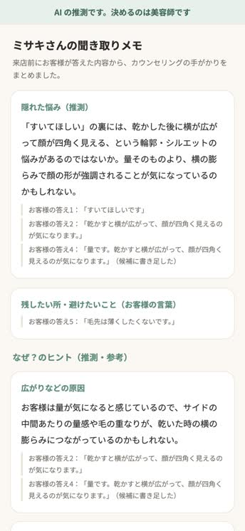

# hashiwatashi（はしわたし）v2 — 来店前の聞き取りと、美容師への「なぜ」のヒント

> Built with Claude: Japan 2026 提出作品。作り手は現役の美容師（コードは書いていない）。実装は Claude。
> 登場するお客様（ミサキさん・ユイさん・アヤノさん）は全員、架空の人です。

**来店前に、AI がお客様のスマホで髪の悩みを1問ずつ聞き、「すいてほしい」の裏に隠れた本当の悩みと、その「なぜ」のヒント、そしてお客様が「残したい所・避けたいこと」を美容師に渡す。AI は何も決めない。全部「推測・参考」で、決めるのは美容師。**

| お客様の画面（来店前・答えの候補ボタン） | 美容師の画面（カウンセリングの前） |
|---|---|
|  |  |

（どちらも本物の Claude で、架空のお客様ミサキさんを画面から最後まで通した時のもの。左は3問目で、AI が問いの中に挙げた「自然乾燥」「ドライヤーだけ」「ブローやアイロンで整える」が候補ボタンになっている。右の「残したい所・避けたいこと」は AI の文ではなく、お客様の答えの原文だけ）

## どんな困りごとか
美容室のカウンセリングで、お客様の「すいてほしい」は、美容師には「毛量を取る」と聞こえやすい。でも本当に気になっているのは「乾かすと横が広がって、顔が四角く見える」ことかもしれない。作り手（美容師）の言葉では：

> 空いて欲しいという言葉の裏には別の要望があるようにその人が気になっていることが本当は隠れていると思う。
> カウンセリングでうまく要望を聞き出せなくて事故るケースはかなり多い、カウンセリングで６割くらいきまるといってもいいと思う

（[INTERVIEW.md](INTERVIEW.md) の原文のまま。音声入力のため「空いて」は「すいて」）

## 何をするか
1. **来店前・お客様のスマホ**：AI が1回に1問ずつ聞く（多くて7問）。終える前に、4つの角度を1回ずつ聞く
   - ① どこが・いつ・どう気になるか
   - ② 家でのケア（洗い方・乾かし方・朝のスタイリング）
   - ③ 今の髪型や扱いやすさ
   - ④ **残したい所・避けたいこと**（「すいて」「軽く」など減らす言葉を言った人には「残したい所」を聞く）
   - お客様には、原因の推測も髪型の提案も言わない
2. **答えの候補ボタン**：2問目から、入力欄の上に候補のボタンが出る（最初の問いには出さない）
   - 候補は「特にないです」「うまく言えないです」と、AI が問いの文の中に挙げた選択肢だけ（例：「自然乾燥・ドライヤーだけ・ブローやアイロンで整える、のどれに近いですか？」）
   - 問いの文に無い物・20文字を超える物・決めた言い方・施術の名前・原因の推測の言葉は、コードが黙って落とす（AI が答えを先に決めないように）
   - 押すと入力欄に入るだけ。お客様は書き足してから送る
3. **美容師の画面**：画面の上に常に「AI の推測です。決めるのは美容師です」。上から順に
   - **隠れた悩み（推測）**
   - **残したい所・避けたいこと（お客様の言葉）**：AI の文は無く、お客様の答えの原文だけ。出ていなければ「聞き取りでは出ていません。当日確かめてください。」
   - **なぜ？のヒント（推測・参考）**：作り手が挙げた3つの種類 ——「広がりなどの原因」「家でのケア」「髪質と髪型が合っているか」。答えに根拠がある物だけ出す
   - **お客様の答え（全部・原文）**
   - どこにも、**もとになったお客様の答えを原文で添える**。候補のボタンから来た答えには「（候補から選んだ）」「（候補に書き足した）」と印が付く
4. **本番のカウンセリングは人**：美容師がヒントを自分の問いと手で確かめる
5. **施術の後・カルテ（美容師のメモ）**：美容師が「今日やったこと」「次に確かめること」を残す（各500字まで）。お客様の要望（答え1）と残したい所・避けたいことは、**お客様の答えの原文のまま自動で写す**。**AI は書かない・何も決めない**
   - 次の来店では、美容師の画面のいちばん上に「前回のカルテ（美容師のメモ・日付）」が出る。お客様の言葉と美容師の言葉は分けて見せる
   - 聞き取りを最初からやり直しても、カルテは消えない（会話とは別のファイル）
   - 美容師の画面を開いた後にお客様が最初からやり直していたら、カルテは残さず「画面を読み込み直してください」と出す（前の来店のメモを、次の来店に混ぜない）

### 決めたこと（作り手の言葉）
- 「けっていしてほしくないかな」「決めない範囲は全部、あくまで推測参考程度に」
- 「あくまでカウンセリングの補助であって欲しい」
- 美容師に渡したいもの：「髪が広がるのはなぜなのか、自宅でのケアの仕方なのか髪質とそのヘアスタイルが合っていないのではないか、そういったことがヒントとしてわかれば施術しやすい」
- 11/7、1つ目の版の良い所を取り入れた：「v2で行きたいけどv1のいいところも取り入れたらどうかな？」「返信予想はあると便利」「うん、3つで進めて」。取り入れたのは3つ ——「残したい所・避けたいこと」を聞く／答えの候補ボタン／作り手の型の言葉（「すいては手段。何が重いのかを聞く」「いちばん最初に触るところがいちばん気になるところ」）。3つ目はアプリには入れず、デモ動画で作り手が自分の口で話す
- 11/7、カルテを足した：「カルテ機能いれたい、作って」。AI は書かず、美容師が書いた言葉とお客様の原文だけを残す形にした（作り手の「けっていしてほしくないかな」に合わせて）

## 作り方（仕様書から）
作り手が講義の型（「作る前に、土台を固める」）で、Claude に1問ずつインタビューしてもらい（11問・答えは [INTERVIEW.md](INTERVIEW.md) に原文のまま）、その原文だけから仕様書1枚（[SPEC.md](SPEC.md)）を書いた。仕様書では作り手の言葉【Ryo】と Claude の提案【Claude案】を分けてあり、作り手が承認してから作った。

- インタビュー・仕様書・確かめと直し：Claude Opus 5.5（Claude Code）
- 実装（画面・API・検査・テスト）：Claude Sonnet 5.5（Claude Code）
- 作り手：答える・選ぶ・承認する（コードは書いていない）

この作品は2つ目の版。1つ目（非公開）は「AI は診断しない・お客様の言葉を美容師の言葉に訳す」作りだった。v2 は作り手の答えから、「なぜ」のヒントを推測として渡す形に変わった（違いは [docs/v1_vs_v2.md](docs/v1_vs_v2.md)。この1枚は 11/7 に良い所を取り入れる前に書いた物）。

## Claude の使い方
- **モデル**：聞き取り＝`claude-sonnet-5-5`（effort low）、美容師へのまとめ＝`claude-opus-5-5`（[lib/config.ts](lib/config.ts) の1か所）
- **構造化出力**：毎回 JSON Schema で受ける（`output_config.format`）
  - 聞き取り：`{ action: "ask" | "finish", text, suggestions }`（`suggestions`＝AI が問いの中に挙げた選択肢）
  - まとめ：`{ hidden_worry: { text, from_answers }, hints: [{ kind, text, from_answers }], keep: { from_answers } }`。`keep` は「残したい所・避けたいこと」を言った答えの番号だけで、AI の文は持たない（言い換えで中身がずれないように、美容師の画面にはお客様の原文がそのまま出る）
- **コードの検査**（[lib/checks.ts](lib/checks.ts)）
  - お客様への問い：「？」は1つだけで文の終わり／決めた言い方（「あなたの髪は」「〜しましょう」「おすすめ」「原因は」「〜でしょう」など）が無い
  - 答えの候補：問いの文の中にそのまま有る・20文字以内・決めた言い方や施術の名前・原因の推測の言葉が無い（外れた物は黙って落とす）
  - 美容師へのヒント：全部の文が推測の言い方（「〜かもしれない」「〜の可能性」）か／言い切り・医療の語が無いか／`from_answers` の番号が実在するか（根拠の無いヒントは出さない）。`keep` も実在する番号だけ残す
- **NG の時**：理由を添えて1回だけ作り直す → まだ NG なら、問いは決まった問いに、ヒントは外す（外した数は美容師の画面に出る）
- **お客様の答えは `<answer>` で囲んで渡す**：中に指示のような文があっても、ただの答えとして読ませる。候補のボタンから来た答えには `via="chip"`（押しただけ）／`via="chip_edited"`（書き足した）を付け、まとめでは「押しただけの答えは弱い裏付け。それだけで言い切らない」と指示している
- **偽物の Claude**（`HASHI_FAKE=1`）：鍵なしで画面とテストが動く

## 試した結果（本物の Claude・今の作り）
架空のお客様3人（[data/personas.json](data/personas.json)：「すいてほしい」「前髪をなんとかしたい」「カラーがすぐ落ちる」）を、お客様役の AI（`claude-sonnet-5-5`。持っている事実だけで答える）が最後まで答えた。11/7 に、3人×2回＝6回。

| 何を | 結果（6回） |
|---|---|
| 問いの数 | 6回とも5問で終わった（上限7問） |
| 「なぜ」のヒント | 毎回3つ（種類は2〜3）。検査で外したヒントは0 |
| 作り直し | まとめは0回。問いは30問中1回 |
| **避けたいこと**（毛先は薄くしたくない・おでこを全部は出したくない・暗すぎる色は避けたい）が「残したい所・避けたいこと」に入ったか | **6回中6回** |
| AI が問いに選択肢を入れて、候補ボタンになったか | 6回中3回（残りの3回は「特にないです」「うまく言えないです」だけ） |

- 前の作り（11/6・「残したい所・避けたいこと」を聞く前）では、試し6回中5回、避けたいことが出てこなかった（[docs/trial_results_2026-11-06.md](docs/trial_results_2026-11-06.md)）
- このほか、画面から p1（ミサキさん）を1回通して録画した（上の画像）。5問・ヒント3つ・外した数0。3問目と4問目は候補のボタンを押して書き足した答えで、美容師の画面では「（候補に書き足した）」と出る。録画では、お客様役の AI に画面の候補ボタンを知らせ、当てはまる時に使うよう頼んだ（そのため4問目の「量」は、お客様役の事実には無い言葉。試し6回ではこの頼みはしていない）
- 試しの結果のファイル `runs/` はリポに入れていない（下の「素の Claude との比べ」の結果だけは `docs/baseline/` に入れた）
- テスト：285本（`npm test`・偽物の Claude だけ・ネット不要・カルテの21本と審査員リンク（[docs/judge_link.md](docs/judge_link.md)）の69本を含む）。型チェック（`npm run typecheck`）も通る

## 素の Claude との比べ（各1回）
同じモデル・同じお客様役（架空の3人）で、指示文が一言だけの「ふつうの AI チャット」に通した。

- **素の Claude のまとめは、読みやすくて中身も良い**（盛らない）。「AI に聞けば同じでは？」は半分当たっている
- 違いは3つ出た
  1. 素の Claude は、1回に2〜4問をまとめて聞いた（3人とも）。v2 は1回1問（コードで止める）
  2. 素の Claude のまとめには「施術の方向性」「おすすめ」が入った（3人とも）＝AI が決める側に寄る。v2 は推測のヒントだけで、施術は言わない
  3. 素の Claude は p1 で「すいてほしい」を「（量を減らしたい）」と書いた＝v2 が防ぎたい言葉のずれを、そのまま美容師に渡している
- 家でのケアは素の Claude でも3人中2人で聞き出せた。避けたいことが出たのは3人中1人（お客様役が自分から言った）
- **読み方の注意**：物差しは v2 の検査（「？」の数・決めた言い方）＝v2 の決まりで相手を測っている。まとめが美容師の役に立つかは測っていない。回数も各1回で少ない
- 回した物と結果：スクリプトは [scripts/baseline.ts](scripts/baseline.ts)、表は [docs/baseline/RESULT.md](docs/baseline/RESULT.md)、生の結果は `docs/baseline/runs_plain/`（p1〜p3・11/7 の各1回）

## 似た物との違い
来店前の AI カウンセリングは、すでにある。形は大きく2つ ——美容師の AI が相談に答えて、メニューや担当を提案して予約へつなぐ形と、お店が作ったシートにお客様が答える形。

hashiwatashi は **AI に答えさせず、決めさせない**。聞いて、目の前の美容師に渡すだけ。公開されているページを読んだ範囲では、「1問ずつ聞く」「推測として出す」「お客様の原文を添える」「AI は決めない」を仕組みにしている物は見つからなかった（読めた範囲の話で、無いとは言えない）。

考え方は、病院の AI 問診に近い。受診の前に聞いて整理して渡し、決めるのは医師、という分業。

## 限界
- **お客様は架空の3人だけ**。回数も少ない（今の作りで6回＋画面から1回）
- **素の Claude との比べは各1回**で、物差しは v2 自身の決まり
- **候補ボタン**：AI が問いに選択肢を入れた時しか、選択肢の候補は出ない（6回中3回）
- **測っていない**：美容師が使って、カウンセリングが短くなったか・満足度が上がったか（作り手が決めた「成功」）は、まだ測っていない。美容師の確認も0件
- 検査は言葉のリストと「？」の数で、意味は見ていない
- 手元で動く試作：保存は JSON ファイル・ログインなし・日本語だけ。お店で使うには、お客様の同意・保存期間・ログインが要る

## これから
- **本物の美容師とお客様で使う**：作り手が決めた「成功」（カウンセリングが短くなる・お客様が伝わったと感じる）を測る
- **カルテを次の聞き取りに生かすか**（今回は入れていない）：前回のカルテを AI に渡すと、AI が「前回はこうだったから」と決める側に寄る心配がある。入れるなら、美容師が画面で確かめる材料に留める
- **カメラ（作り手の案・今回は入れていない）**：「本当はカメラでその人の正面を撮影して似合う髪型を導き出すのも入れたかったなぁ」。入れるなら条件がある
  - AI が似合う髪型を決めるのではなく、**美容師が確かめる材料の1つ**として出す（「けっていしてほしくないかな」とぶつからないように）
  - 顔写真は、お客様の同意と保存の決まりを先に作る

## 動かし方
```bash
npm install
ANTHROPIC_API_KEY=... npm run dev   # http://localhost:3400
HASHI_FAKE=1 npm run dev            # 鍵なし・偽物の Claude
npm test                            # テスト285本（偽物の Claude だけ・ネット不要）
ANTHROPIC_API_KEY=... npm run trial # 架空のお客様3人を本物で通す（npm run trial -- --fake で偽物）
```
- トップ（`/`）から、お客様の画面（`/customer/p1`）と美容師の画面（`/stylist/p1`）を開ける
- 会話は `data/runtime/<id>.json`、カルテは `data/runtime/<id>.karte.json` に残る（どちらも git の外）。やり直す時は、お客様の画面の「最初からやり直す」（カルテは消えない＝次の来店として「前回のカルテ」に出る）

## ファイル
| 場所 | 中身 |
|---|---|
| `INTERVIEW.md` / `SPEC.md` | 作り手へのインタビュー（原文）と仕様書1枚 |
| `lib/interview.ts` | 聞き取り（次の1問 or 終わり・答えの候補）＋検査＋作り直し |
| `lib/summarize.ts` | 隠れた悩み・ヒント・残したい所＋検査＋作り直し・外す |
| `lib/checks.ts` | 決めた言い方・推測の言い方・答えの番号・候補の検査（語のリストはここだけ） |
| `lib/claude.ts` / `server/claude.ts` | Claude を呼ぶ口（本物／偽物） |
| `app/customer/[id]` / `app/stylist/[id]` | お客様の画面／美容師の画面 |
| `app/api/interview` / `app/api/summary` / `app/api/karte` | 画面から呼ぶ API |
| `server/karte.ts` | カルテの保存（来店ごとに1件・AI は使わない） |
| `scripts/trial.ts` | お客様役の AI と最後まで通す試し |
| `scripts/baseline.ts` / `docs/baseline/` | 素の Claude との比べ（回した物／表 `RESULT.md` と生の結果 `runs_plain/`） |
| `tests/` | テスト |

---

## English summary
**hashiwatashi v2** — before a salon visit, an AI interviews the customer on her phone, one question at a time, and hands the stylist three things: the **hidden worry** behind words like "please thin it out", **what she wants to keep or avoid** (shown only as her own words — no AI text), and **"why" hints** in three kinds the stylist asked for (what may be causing it / home care / whether hair type and style fit). Everything is framed as a guess; every item carries the customer's own answers verbatim; a banner says "These are the AI's guesses. The stylist decides." The AI never decides anything — the counseling stays human. After the visit, the stylist leaves a short karte (client record): what was done today and what to check next time. The customer's own words (her request and what to keep or avoid) are copied in verbatim, the AI writes nothing, and on the next visit the stylist's screen opens with "last karte" at the top.

Before finishing, the interview covers four angles once each: where/when/how it bothers her, home care, the current style, and what to keep or avoid (customers who ask to "thin" or "lighten" are asked what to keep). From the second question, answer chips appear: "nothing in particular", "I can't put it into words", plus only the choices the AI wrote inside the question itself. Code silently drops chips that aren't in the question, run over 20 characters, or contain decisive phrasing, treatment names or guessed causes. Tapping a chip only fills the input box; the stylist sees which answers came from a chip.

Built by a working hairdresser who doesn't write code. Claude interviewed the hairdresser one question at a time (11 questions, kept verbatim in `INTERVIEW.md`), wrote a one-page spec from those words only (`SPEC.md`), and built it after the hairdresser approved it (spec, review and fixes: Claude Opus 5.5; implementation: Claude Sonnet 5.5, both in Claude Code).

Claude usage: Sonnet 5.5 for the interview and Opus 5.5 for the stylist summary, both with JSON-schema structured output (`suggestions` for chips; `keep` holds only answer numbers). Code checks reject decisive phrasing, non-hedged hints, medical claims and citations to answers that don't exist; one regeneration with reasons, then a fixed fallback or the hint is dropped. Customer answers are wrapped in `<answer>` tags, marked `via="chip"` / `via="chip_edited"` so a tapped chip counts as weaker evidence.

Results with real Claude on three fictional customers (6 runs on the current version): every run ended in 5 questions with 3 hedged hints and none dropped; the summary was never regenerated and 1 of 30 questions was. What the customer wanted to avoid reached the stylist's "keep / avoid" card in 6 of 6 runs (the earlier build missed it in 5 of 6). The AI offered choice chips in 3 of 6 runs. 285 tests pass (21 of them for the karte, 69 for the judge link).

Compared with plain Claude (same models, a one-line prompt, one run each): its summaries read well, but it asked 2–4 questions at once, put treatment suggestions in the summary, and rewrote "please thin it out" as "wants less volume". Note the yardstick is v2's own rules (script: `scripts/baseline.ts`; table and raw outputs: `docs/baseline/`). Pre-visit AI counseling already exists; what hashiwatashi adds is that the AI neither answers nor decides — it asks, and hands the material to the stylist in front of the customer.

Limits: fictional customers only, few runs, no stylist has used it yet, checks are word lists, local prototype (JSON files, no login, Japanese only). Next: real stylists and customers; the maker's camera idea only as material for the stylist to check, with consent and storage rules first.
